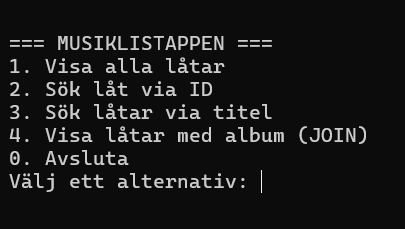

# Musiklistappen — Oliver Ågren

---

## Vad appen gör

Ett konsolprogram i C# som läser en SQLite-databas med Billie Eilishs låtar och album. I menyn kan man visa alla låtar, söka på ID eller titel och visa låtar med albumnamn.

## Så kör du den

```
cd MusikApp
dotnet run 
```

Kräver .NET 10 SDK. Databasen `billie_eilish.db` ska ligga i mappen `MusikApp/` (sökvägen står i `appsettings.json`).

## Så ser huvudmenyn ut



---

## Mina designval (VG)

1. **Hur designade du din databas? Varför valde du just den strukturen?**

   Databasen har två tabeller: `Songs` och `Albums`. Ett album har flera låtar, så varje låt har en `Album_id` som pekar på sitt album. Då står albumets uppgifter på ett ställe i stället för att upprepas på varje låt.

2. **Vilket SQL-krav valde du (JOIN eller subquery) och varför passade det din app?**

   Jag valde JOIN. `Songs` har bara ett album-ID, vilket inte säger användaren något. Med en JOIN på `Songs.Album_id = Albums.ID` visar appen varje låt tillsammans med albumets namn.

3. **Vad skulle du gjort annorlunda om du byggde om den från scratch?**

   Jag skulle ha lagt in databasfilen i projektet och ställt in att den kopieras till `bin` direkt från början. Först fanns inte filen där, så appen skapade en tom databas och jag fick felet `no such table: Songs`. Jag skulle också bygga funktioner för att lägga till och ta bort låtar.